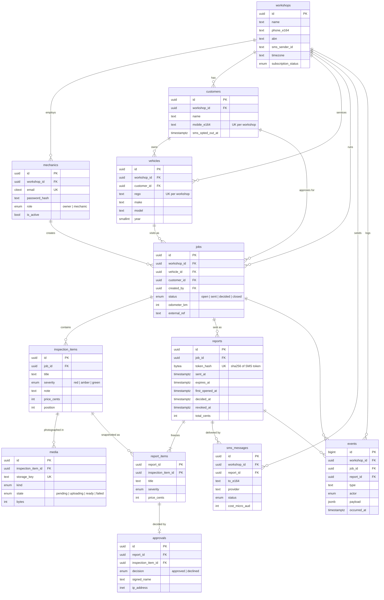

# MechanicPulse — Data Model (v1, MVP core flow)

Owner: Madhavan (database). Schema lives in `db/migrations/0001_initial_schema.sql`.
This replaces the rough v1 sketch that used to be in `CLAUDE.md`.

**Engine:** PostgreSQL 16+ on Amazon RDS, `ap-southeast-2` — as already decided in
`docs/product-decisions.md`. Nothing here needs a Postgres extension that RDS doesn't
ship (`pgcrypto`, `citext` only).

---

## The flow it models

```
mechanic logs in → opens a JOB for a VEHICLE (owned by a CUSTOMER)
  → adds INSPECTION ITEMS (severity, price) with MEDIA (photos in S3)
  → sends a REPORT (frozen REPORT ITEMS) by SMS_MESSAGE
  → customer opens link, submits an APPROVAL per item
  → every step also written to EVENTS (the measurement layer)
```

## ERD



## Tables

| Table | One row is… | Notes |
|---|---|---|
| `workshops` | a paying (or pilot) shop — the tenant | `sms_sender_id` ≤ 11 alphanumeric chars (AU sender ID limit). `timezone` for rendering times. |
| `mechanics` | a person who logs in | Email is globally unique (login doesn't ask which shop). `password_hash` must be bcrypt. `role` = `owner` / `mechanic` — no roles engine, per the no-Keycloak decision. |
| `customers` | a vehicle owner at one shop | Unique `(workshop_id, mobile_e164)` so the same number isn't duplicated. `sms_opted_out_at` for STOP replies (Spam Act). |
| `vehicles` | a car at one shop | `rego` stored normalised (`ABC123`, upper, no spaces). Unique per workshop, matching `types.ts`. |
| `jobs` | one visit | Holds `customer_id` itself, not only via the vehicle — the approver is fixed for this job even if the car changes hands later. |
| `inspection_items` | a finding | Editable draft. Price is integer cents. |
| `media` | one photo/video in S3 | Row created at presign (`pending`), set to `ready` when the browser confirms the PUT. Stores the S3 key, never a URL. Partial index finds stuck uploads for a cleanup job. |
| `reports` | one SMS link | Only `sha256(token)` is stored — a DB leak can't be replayed as live links. Default expiry 7 days. Max one live report per job (partial unique index). |
| `report_items` | an item exactly as the customer saw it | Frozen copy of title/severity/price at send time. Append-only. |
| `approvals` | the customer's decision on one item | One per `(report, item)`, FK to `report_items` so you can't approve something that wasn't in the report. Append-only; trigger rejects it if the report is revoked, expired or already submitted. |
| `sms_messages` | an outbound text | Provider status + cost, so the ~$84/month margin assumption can be checked with real numbers. Provider-agnostic (Twilio vs AU aggregator still open). |
| `events` | something that happened | The measurement layer. Append-only, `type` checked against a list (add new types with a one-line migration). |

## Key design decisions

1. **Tenant safety in the schema, not just the API.** Every tenant table has
   `workshop_id`, and child rows reference parents with composite FKs
   `(workshop_id, id)`. A job in shop A physically can't point at a vehicle in
   shop B, even if an API route forgets a `WHERE workshop_id = …`. This is also
   what makes Postgres Row-Level Security an easy add later.
2. **What the customer saw is frozen.** The mechanic can keep editing
   `inspection_items`; `report_items` is a snapshot taken at send. Approvals point
   at the snapshot. This is the record you'd need in a dispute ("I approved $289,
   not $999").
3. **Report tokens are hashed.** The raw token exists only in the SMS. The API does
   `WHERE token_hash = sha256($token) AND revoked_at IS NULL AND expires_at > now()`.
4. **"Single-use" token = usable until submitted.** CLAUDE.md calls the token
   single-use; the customer will realistically open it more than once. The model
   lets them open it freely and locks it once `decided_at` is set. Needs a quick
   team confirmation.
5. **Append-only where it matters.** `report_items`, `approvals`, `events` reject
   UPDATE/DELETE via trigger.
6. **Integer cents, E.164 phones, UTC timestamps** — enforced with domains/checks
   (`money_cents`, `phone_e164`), same rules as `packages/shared/types.ts`.
7. **UUID keys** so the client can reference rows safely in URLs without leaking
   counts; `events` uses a bigint identity because it is high-volume and internal.

## Metrics this supports (from `events` + `reports`)

- Reports sent per workshop per week — `events` where `type = 'report.sent'`
- Open rate — `reports.first_opened_at IS NOT NULL`
- Time to decision — `reports.decided_at - reports.sent_at`
- Approval rate (count and $) — `approvals` joined to `report_items`
- Upload reliability — `media.upload_failed` vs `media.upload_succeeded` events
- SMS delivery rate and cost — `sms_messages.status`, `cost_micro_aud`

## Proposed changes to `packages/shared/types.ts`

`types.ts` is the contract and changes first — these need Akash's OK before the API
uses them:

- `Job`: add `customerId`, `createdBy`, optional `odometerKm`, `closedAt`
- `Report`: add `firstOpenedAt?`, `decidedAt?`, `totalCents`
- New `Mechanic` type (`id, workshopId, name, email, role`) — never expose `passwordHash`
- New `ReportItem` type (the frozen snapshot the customer page renders)
- `Media`: add `contentType`, `position`
- `Workshop`: add `smsSenderId?`, `subscriptionStatus`

## Running it locally

```bash
createdb mechanicpulse_dev
psql -v ON_ERROR_STOP=1 -d mechanicpulse_dev -f db/migrations/0001_initial_schema.sql
psql -v ON_ERROR_STOP=1 -d mechanicpulse_dev -f db/seed/dev_seed.sql      # dev only
psql -v ON_ERROR_STOP=1 -d mechanicpulse_dev -f db/tests/schema_checks.sql # rolls back
```

Seed logins: `owner@demo.test` / `jo@demo.test`, password `password123`.

## Out of scope for v1 (deliberately)

Subscription billing/invoices, parts & labour breakdown per item, multiple
workshop locations, integration with workshop management software (only the
`external_ref` placeholder exists), Row-Level Security policies, data retention jobs.

## Open questions for the team

- Is "open freely until submitted" the right meaning of single-use tokens? (decision 4)
- Can a customer approve some items now and the rest later, or is it one submission? (Model assumes one submission per report; a revised quote = new report.)
- Migration runner: plain SQL files today; pick `node-pg-migrate` or `dbmate` when the API starts talking to RDS.
